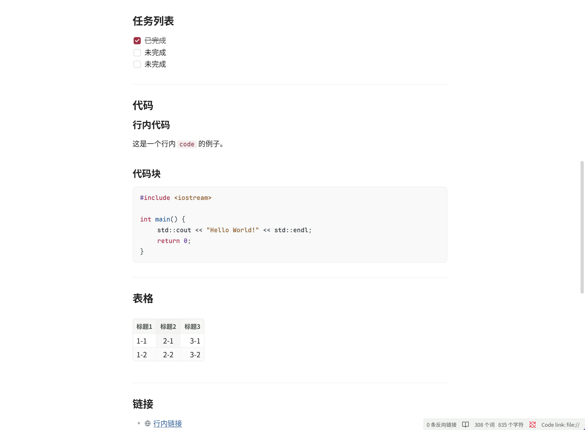
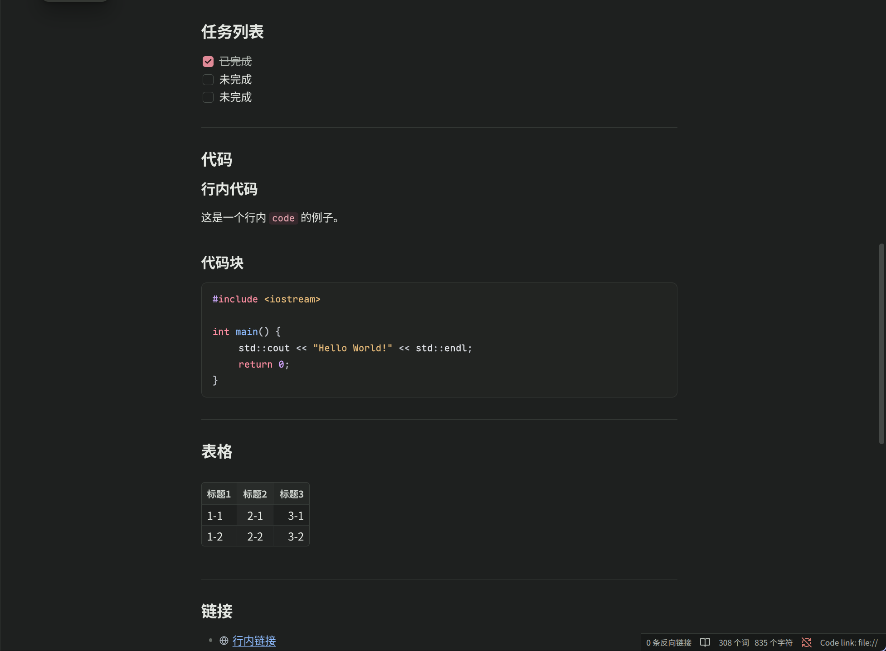

[English](README.md)

# Stillmark / 静痕 for Obsidian

静痕（Obsidian 版）是[思源笔记 Stillmark / 静痕主题](https://github.com/houm01/siyuan-theme-stillmark)在 Obsidian 上的移植，以干净的白色编辑区和清晰的长文阅读体验为核心，保持同一套安静、克制的视觉语言。

移植与维护：yunforge（<xing.m@proton.me>）。

## 预览

| Light Theme | Dark Theme |
| --- | --- |
|  |  |

## 主要特性

- 亮色模式以纯白编辑区和低饱和中性色界面为主，并配有校准一致的暗色模式
- 紧凑的暗莓红行内代码，不改变正文行高
- 代码块使用扁平的正文嵌入式面板，并为 Prism / CodeMirror 提供完整且两视图对齐的静痕红、蓝、紫、琥珀语法色板
- 精选的等宽字体栈，编辑与阅读视图共享同一代码字号；实时预览代码块带同款细边框；Mermaid 图表沿用代码面板
- 已完成任务以克制的灰色删除线淡出
- 编辑与阅读视图的超链接保持熟悉的蓝色下划线；外部链接显示克制的地球图标
- 引用块使用低饱和暗莓红竖线和正体暖灰正文
- 提示块（Callout）使用低对比度中性面板、1px 细边框和克制的图标底色
- 标签使用克制的焦点蓝胶囊样式；属性面板中的文档标签遵循同一处理
- 紧凑的中性工作台壳层：页签、侧栏、状态栏和菜单保持安静，文档始终是主表面
- 当前文件、活动页签和搜索命中使用低饱和莓红强调色
- 纯 CSS 主题，不包含 JavaScript

## 安装

将本文件夹复制到仓库的 `.obsidian/themes/` 目录，**并把文件夹重命名为 `Stillmark`**——Obsidian 只有在文件夹名与 `manifest.json` 的 `name` 字段完全一致时才会列出主题：

```bash
cp -r obsidian-theme-stillmark <你的仓库>/.obsidian/themes/Stillmark
```

然后在 **设置 → 外观 → 主题** 中选择 **Stillmark**。如需在亮暗两种模式下使用，请分别启用。

## 文件结构

- `manifest.json`：主题元数据
- `theme.css`：主题变量及组件样式

## 许可证

[MIT](LICENSE)
